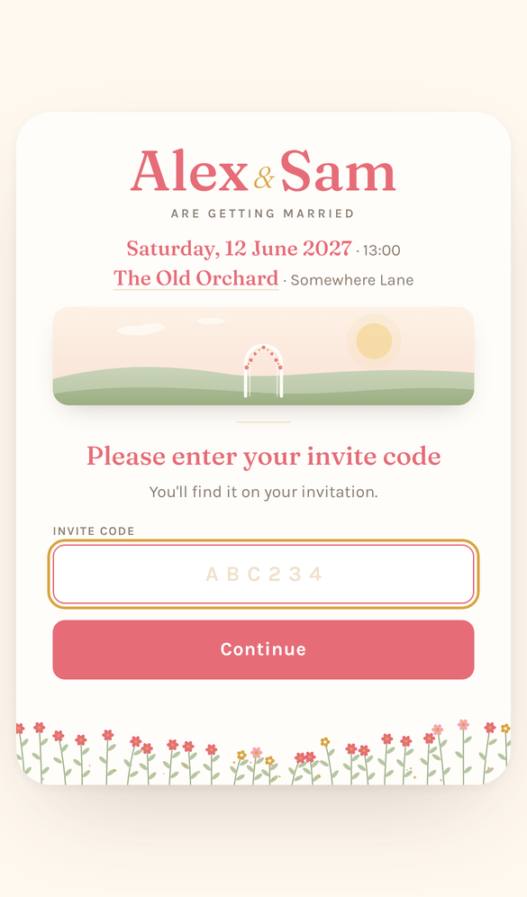
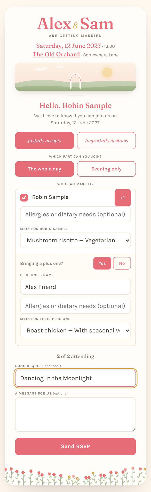
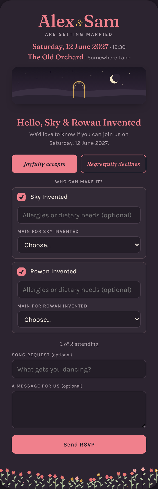
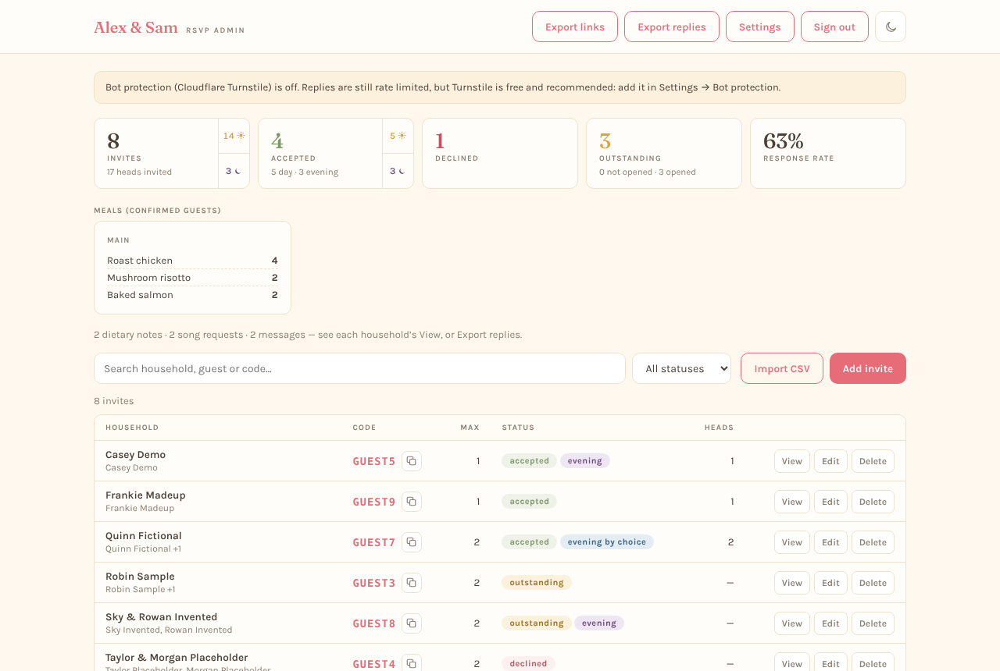
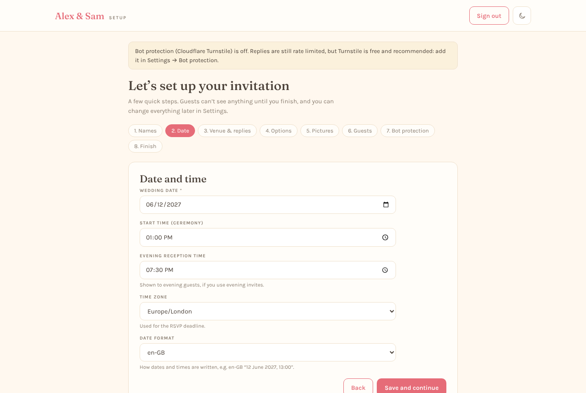

# RSVPer

A self-hostable wedding invitation and RSVP site that runs on your own
Cloudflare account, on the free plan.

Each household gets a short code (and a personal link). Guests open their
invitation, say who's coming, add plus ones, and pick meals if you want them
to. You manage everything from a private admin page: your names and date, the
wording, the guest list, and the replies.

[](https://deploy.workers.cloudflare.com/?url=https://github.com/pyro142/RSVPer)

## Features

- **One-page invitation**, mobile-first, with confetti when someone accepts.
- **Household codes** using only unambiguous characters (no 0/O or 1/I/L), plus
  a personal link for each household.
- **Named guests and plus ones**, with a per-household party-size cap enforced on
  the server.
- **One reply per household**: no editing after submitting (you can reset a reply
  from the admin if needed).
- **Optional extras**, each hidden unless you turn it on: meal choices (with an
  optional multi-course menu), dietary needs, a song request, and a message to the
  couple.
- **Evening guests** (optional): invite some households to the reception only, with
  their own time and night-time look. Day guests can choose "evening only".
- **Admin dashboard**: live counts, meal totals, search, CSV import and export,
  invite links for mail merge.
- **Everything is set from the admin**: names, date, venue, wording, pictures,
  features. No code changes, no redeploys.
- **Colour themes**: 14 one-tap themes (light and dark) or your own two colours. Text,
  buttons and lines adjust automatically so everything stays readable, on the guest
  page and in the admin.
- **Private by default**: hidden from search engines, no analytics, no trackers, no
  third-party fonts or scripts.
- **Secure by default**: brute-force protection on codes, signed admin sessions,
  CSRF protection, optional Cloudflare Turnstile and Cloudflare Access.

## Screenshots

All screenshots use made-up data from `npm run db:seed:local`.

<table>
  <tr>
    <td width="33%"></td>
    <td width="33%"></td>
    <td width="33%"></td>
  </tr>
  <tr>
    <td>Guests enter their code (or use their personal link)</td>
    <td>Replying: who's coming, plus ones, meals, song request</td>
    <td>Evening guests get their own time and look</td>
  </tr>
</table>





## Deploy

### With the button (recommended)

1. Click **Deploy to Cloudflare** above and sign in to Cloudflare (a free account
   is fine).
2. Connect GitHub or GitLab. Cloudflare copies this project into a new repository
   in your account, so you own your copy.
3. On the setup page:
   - Pick names for the Worker and the database (the defaults are fine).
   - **ADMIN_PASSWORD**: the password for your admin page. At least 12 characters.
   - **SESSION_SECRET**: a random string of at least 32 characters. Generate one
     with `openssl rand -base64 32`, or a password manager's generator.
4. Select **Deploy**. Cloudflare creates the database, builds the site, sets up
   the database tables and publishes it. It takes a minute or two.
5. Open `https://<your-worker>.<your-subdomain>.workers.dev/admin`, sign in, and
   follow the setup wizard.

Guests can't see or reply to anything until you finish the setup wizard.

**Using your own domain:** in the Cloudflare dashboard, open your Worker →
Settings → Domains & Routes → Add → Custom domain (e.g. `rsvp.example.com`).

### Manually with Wrangler

You'll need Node 20 or newer.

```bash
git clone https://github.com/pyro142/RSVPer.git
cd RSVPer
npm install
npx wrangler login
npx wrangler d1 create rsvper
```

Copy the `database_id` that `d1 create` prints into `wrangler.jsonc`, replacing
the all-zero placeholder. Then:

```bash
npm run deploy
npx wrangler secret put ADMIN_PASSWORD
npx wrangler secret put SESSION_SECRET
```

`npm run deploy` builds the site, applies database migrations, and deploys. Open
`/admin` on the URL it prints.

## First-run setup

The setup wizard walks you through the steps below, with a **live preview** of your
invitation beside it (on a wide screen) that updates as you type and that you can click
through as a guest:

1. **Names**
2. **Colours**: pick a theme with one tap, or your own background and brand colour
3. **Date**, start time, evening reception time, time zone and date format
4. **Venue** (with help getting a map link), **RSVP deadline** and a contact line
5. **Options**: evening guests (on by default), meal choices (and your menu), dietary
   needs, song requests, messages
6. **Pictures**: built-in artwork, a link to your own image, or a small upload
7. **Guests**: import a CSV, or skip and add them from the dashboard
8. **Bot protection**: optional Turnstile keys
9. **Finish**: the invitation goes live

Everything can be changed later in **Settings**.

## Importing guests

Upload a CSV with a header row and **one row per guest**. Rows with the same
household are grouped into one invite. See [`examples/guests.csv`](examples/guests.csv).

| Column           | Required | Meaning                                                                          |
| ---------------- | -------- | -------------------------------------------------------------------------------- |
| `household`      | yes      | Name used in the greeting, e.g. "The Example Family"                             |
| `guest`          | yes      | A named guest on that invite                                                     |
| `plus_one`       | no       | `yes` if this guest may bring a plus one                                         |
| `max_party_size` | no       | Cap on attendees for the household. Defaults to named guests + allowed plus ones |
| `evening`        | no       | `yes` for an evening-only household (turn on evening guests first)               |

You get a preview first. If any row has a problem, nothing is imported until
it's fixed.

## Bot protection (Cloudflare Turnstile)

Optional but recommended, and free. Without it, RSVPer still rate-limits replies
and wrong codes.

1. In the Cloudflare dashboard, open **Turnstile** → **Add widget**.
2. Add the hostname guests use (your `workers.dev` address and/or custom domain)
   and keep the mode as **Managed**.
3. Copy the **Site Key** and **Secret Key** into **Admin → Settings → Bot
   protection** (or the wizard's Bot protection step).

Prefer to keep keys out of the database? Set `TURNSTILE_SITE_KEY` and
`TURNSTILE_SECRET_KEY` as secrets on the Worker instead; those take precedence.

## Admin sign-in with Cloudflare Access (optional)

By default the admin uses the password you chose at deploy time (changeable in
Settings). If you already use Cloudflare Zero Trust, you can protect the admin
with Cloudflare Access instead:

1. Create an Access application for your site's `/admin` path (and add the
   `/api/admin` path too), with a policy allowing your email addresses.
2. On the Worker, set the variable `ADMIN_AUTH_MODE` to `access`, and the secrets
   `ACCESS_TEAM_DOMAIN` (e.g. `yourteam.cloudflareaccess.com`) and `ACCESS_AUD`
   (the application's Audience tag).

RSVPer verifies the Access token's signature on every admin request, so the
`workers.dev` address is protected too.

## Local development

Want to help improve RSVPer? See [CONTRIBUTING.md](CONTRIBUTING.md).

```bash
npm install
cp .dev.vars.example .dev.vars   # then fill in both values
npm run dev                      # builds, sets up the local database, starts the server
```

Open http://localhost:8787/admin. Other scripts: `npm test`, `npm run lint`,
`npm run typecheck`, `npm run db:migrate:local`, `npm run db:seed:local`.

## Updating your copy

The deploy button creates a standalone copy of this repository. To pull in later
improvements:

```bash
git remote add upstream https://github.com/pyro142/RSVPer.git
git fetch upstream
git merge upstream/main
git push
```

If there's a conflict in `wrangler.jsonc`, keep **your** `database_id`. Pushing
redeploys automatically and applies any new database migrations.

## Free-plan limits

RSVPer is designed for the Cloudflare free plan. For a typical wedding you will
use a tiny fraction of it. Current limits are on
[Cloudflare's pricing pages](https://developers.cloudflare.com/workers/platform/pricing/);
the ones that matter are Worker requests per day and D1 rows read/written per
day. Uploaded images are stored in D1, so they're capped at 1 MB each and 20
in total.

## Privacy

- No analytics, tracking pixels or third-party fonts or scripts. The only
  outside service the guest page can load is Cloudflare Turnstile, and only if you
  turn it on.
- Search engines are asked not to index the site (`noindex` headers, meta tag and
  `robots.txt`). You can turn this off in Settings.
- Guest IP addresses are never stored. A keyed hash is kept for rate limiting.
- Your data lives in your own Cloudflare account. Exports are CSV downloads to
  your device.

## FAQ and troubleshooting

**Can guests change their reply?**
No, by design: one reply per household. If someone needs to change theirs, open
their household in the dashboard and choose **Reset reply**. Their link keeps
working and they can reply again.

**A code has been shared with the wrong people.**
Open the household, choose **New code**, and send them the new link. The old code
stops working immediately.

**Someone says their code doesn't work.**
Codes never contain 0, O, 1, I or L, so check for those. Too many wrong attempts
from one connection trigger a cool-off (and a 24-hour lockout after many); the
guest sees "Too many attempts". You can loosen the limits in **Settings →
Advanced: security**, or just send them their personal link.

**The admin says "Setup problem" or "isn't set up yet".**
A deploy secret is missing or too short. In the Cloudflare dashboard open your
Worker → **Settings → Variables and secrets**, and set `ADMIN_PASSWORD` (12+
characters) and `SESSION_SECRET` (32+ characters).

**I forgot the admin password.**
If you changed it in Settings, the stored password wins. To reset it, delete the
`admin_credentials` row in your D1 database (Cloudflare dashboard → D1 → your
database → Console: `DELETE FROM admin_credentials;`), then sign in with the
`ADMIN_PASSWORD` secret, which you can also change in the dashboard.

**The deploy failed at the migrations step.**
Check that `wrangler.jsonc` has your real `database_id` (the button sets it for
you; for manual deploys run `npx wrangler d1 create rsvper`) and that the
database binding is still called `DB`.

**Guests see "This invitation isn't ready yet".**
Finish the setup wizard at `/admin/setup`.

**Can I use my own photo?**
Yes: in **Settings → Images**, link to an image you host or upload one (PNG, JPEG
or WebP, up to 1 MB).

**Can I show the RSVP form inside my existing wedding website?**
Yes. Add your website's address under **Settings → Privacy → Allow embedding on
these sites**, then embed your RSVPer address in an `<iframe>`.

**Does it send emails?**
No. Share each household's link however you like; **Export links** gives you a
CSV for mail merge.

**Do I need a paid Cloudflare plan?**
No. Everything runs on the free plan.

## Licence

RSVPer is **source-available** under the
[PolyForm Noncommercial License 1.0.0](LICENSE).

- **You can** use it, deploy it for your own (or a friend's) wedding, change it,
  and share it, for any non-commercial purpose.
- **You can't** sell it, sell access to it, or run it as a paid or commercial
  service.

Because it doesn't allow commercial use, this isn't "open source" in the OSI
sense. If you'd like to use it commercially, open an issue to ask.

Third-party parts keep their own licences: the Fraunces and Karla fonts (SIL Open
Font License) and canvas-confetti (ISC). Their licence files are copied into
`public/vendor/` when you build.
